<p align="center">
  <a href="README.md">🇧🇷 Português</a> · <b>🇺🇸 English</b> · <a href="README.es.md">🇪🇸 Español</a>
</p>

<p align="center">
  
</p>

<p align="center">
  MIT License · Manifest V3 · Chrome, Edge, Opera, Brave and Firefox 128+ · No data collected
</p>

<p align="center">
  <a href="#install">Install</a> ·
  <a href="#tools">Tools</a> ·
  <a href="#privacy-and-permissions">Privacy</a> ·
  <a href="#development">Development</a> ·
  <a href="CONTRIBUTING.md">Contributing</a>
</p>

---

**Neruz Inspect** opens a toolbar on top of any website, with tools for color, typography, layout, code, motion, tech and page analysis. No DevTools and no juggling extensions.

It is **free**, **open source (MIT)** and runs **in your browser**. No account, no server and no paid version.

## Tools

| Group          | Tools                                                                                                                                                             |
| -------------- | ----------------------------------------------------------------------------------------------------------------------------------------------------------------- |
| **Color**      | Eyedropper · Page palette · Contrast checker · Color converter · Gradients & shadows · Color blindness                                                            |
| **Typography** | Font finder · Page fonts · Font tester · Type scale                                                                                                               |
| **Layout**     | Ruler · Box model · Grid & Flexbox · Overflow finder · Z-index map · Breakpoints · Outlines · Design overlay                                                      |
| **Code**       | Copy styles · Copy component · Extract design system · Live edit                                                                                                  |
| **Motion**     | Motion inspector · Page toggles                                                                                                                                   |
| **Tech**       | Tech stack · Pixels & tags · Cookies & storage · JSON viewer                                                                                                      |
| **Page**       | SEO & meta tags · Structured data · Robots & sitemap · Link checker · Assets · Icons & favicons · Core Web Vitals · Accessibility · PDF report _(in development)_ |
| **Utilities**  | Unit converter · Lorem ipsum · Form filler · QR code · Copy history                                                                                               |

Each group has an icon on the toolbar. Click it to see its tools, or press `/` and search by name or keyword.

## Highlights

- **One toolbar.** Color, font, measurement, animation, tech and analysis in one place, without an extension for each.
- **Runs only when you open it.** The toolbar exists only on the tab where you opened it. Closing it removes what it drew on the page.
- **Nothing changes on the real site.** Edits, swapped fonts and outlines show only on your screen. Reloading the page undoes everything.
- **No AI and no telemetry.** No data about you is sent outside your browser.
- **Honest about its limits.** Generated Tailwind is an approximation. Performance is measured on your machine and connection, not Google's field data. `HttpOnly` cookies don't show up, because the browser doesn't expose them to the page.
- **Native pt-BR, en and es.** The texts were written in each language, not translated word by word.

## Privacy and permissions

Nothing leaves your browser. The extension has no server of its own, asks for no account, uses no analytics and collects no data. Preferences and copy history stay in the browser's local storage. All the code ships in the package: there is no remote code.

The only connections are the ones you ask for: checking links or downloading files from other sites, and loading a Google font when you pick one in "Font tester".

| Permission                                          | Why                                                                                                          |
| --------------------------------------------------- | ------------------------------------------------------------------------------------------------------------ |
| `storage` (required)                                | Save language, color format, unit and copy history, only in this browser                                     |
| `activeTab` (required)                              | Give temporary access only to the current tab, when you click the icon or use the shortcut                   |
| `scripting` (required)                              | Inject the extension's own script into that tab to read styles, fonts, tags and page data                    |
| `clipboardWrite` (optional)                         | Copy values to the clipboard, requested when you copy                                                        |
| Access to `http://*/*` and `https://*/*` (optional) | Check links and download files from other domains. Requested only with your click, and removable in settings |

We don't ask for access to all sites, the list of tabs, cookies, the browser debugger, or to intercept network traffic (`webRequest`). Minimum permissions are the rule: anything a tool doesn't need is not requested.

## Install

| Browser              | Where                          |
| -------------------- | ------------------------------ |
| Chrome, Brave, Opera | Chrome Web Store (coming soon) |
| Edge                 | Edge Add-ons (coming soon)     |
| Firefox 128+         | Firefox Add-ons (coming soon)  |

### Load unpacked, from the build

1. Clone the repository and build the extension with `pnpm install` followed by `pnpm build:ext` (Chrome, Edge, Brave, Opera) or `pnpm build:ext:firefox` (Firefox).
2. **Chrome/Edge/Brave/Opera:** open `chrome://extensions` (on Edge, `edge://extensions`), turn on **Developer mode** and click **Load unpacked**. Pick the folder `apps/inspect/.output/chrome-mv3`.
3. **Firefox:** open `about:debugging#/runtime/this-firefox`, click **Load Temporary Add-on** and pick the `manifest.json` inside `apps/inspect/.output/firefox-mv3`.

### How to use

1. Open a regular website and click the Neruz Inspect icon, or press `Alt+Shift+I`.
2. Pick a tool from the toolbar, or press `/` to search.
3. `Esc` exits the tool. Press `Esc` again to close everything.

Browsers don't let extensions run on internal pages (such as settings and the new tab), in the extension store, or in the PDF viewer.

## Development

Requirements: Node 22.23.4 or newer and pnpm 12.

```bash
pnpm install
pnpm dev:ext            # extension in development mode (Chrome)
pnpm dev:ext:firefox    # extension in development mode (Firefox)
pnpm dev:landing        # presentation site in development mode
pnpm build:ext          # builds apps/inspect/.output/chrome-mv3
pnpm build:ext:firefox  # builds apps/inspect/.output/firefox-mv3
pnpm build:landing      # builds the presentation site
pnpm lint && pnpm typecheck && pnpm test
```

| Script                           | What it does                                                                                                    |
| -------------------------------- | --------------------------------------------------------------------------------------------------------------- |
| `dev:ext`, `dev:ext:firefox`     | Runs the extension in development mode (WXT)                                                                    |
| `build:ext`, `build:ext:firefox` | Builds the extension package for each browser                                                                   |
| `dev:landing`, `build:landing`   | Runs or builds the presentation site (Astro)                                                                    |
| `lint`                           | Checks the code with Biome                                                                                      |
| `typecheck`                      | Runs the type check in every package                                                                            |
| `test`                           | Runs the tests with Vitest                                                                                      |
| `test:e2e`                       | Builds with `VITE_NI_E2E=true` (open shadow root for tests only; closed in production) and drives real Chromium |

### Monorepo structure

| Folder            | Contents                                         |
| ----------------- | ------------------------------------------------ |
| `apps/inspect`    | Extension (WXT, React, TypeScript)               |
| `apps/landing`    | Presentation site (Astro, Three.js, GSAP, Lenis) |
| `packages/core`   | Shared messaging and async utilities             |
| `packages/i18n`   | pt-BR, en and es locales and translator          |
| `packages/ui`     | Design tokens, buttons and graphic components    |
| `packages/config` | Base TypeScript configuration                    |
| `docs`            | Architecture, decisions and visual assets        |

Stack: pnpm workspaces, WXT 0.21.5, React 19.3.1, Zustand 5.1.0, Valibot 1.5.0, lucide-react 1.72.0, TypeScript 6.0.3, Biome 2.6.7, Vitest 4.1.12. The landing uses Astro 7.4.11, GSAP 3.15.1, Lenis 1.3.27 and Three.js 0.187.0.

### How to create a tool

Each tool is a folder at `apps/inspect/src/tools/<group>/<toolId>/` with a default module that describes its icon, mode and panel. The full step-by-step guide, with the project's ready-made pieces, is in [COMO-CRIAR-FERRAMENTA.md](apps/inspect/src/tools/COMO-CRIAR-FERRAMENTA.md) (in Portuguese). In short:

1. Create the tool folder and its `index.tsx`.
2. Register the module in the array of `apps/inspect/src/tools/<group>/index.ts`, in toolbar order.
3. Write `name`, `desc` and `keywords` in `apps/inspect/src/i18n/<group>.ts`, in all three languages.

Architecture and internal contracts are in [docs/ARQUITETURA.md](docs/ARQUITETURA.md) (in Portuguese). Decisions are in [docs/DECISOES.md](docs/DECISOES.md) (in Portuguese).

## Contributing

Issues and pull requests are welcome. Read [CONTRIBUTING.md](CONTRIBUTING.md) before opening a PR. For big changes, open an issue first so we can talk it through.

## License

[MIT](LICENSE). Use, study, modify and share it freely, including in commercial projects, as long as you keep the copyright notice.

## The Neruz family

Neruz Inspect is part of **Neruz Extensions**, a family of tools for people who build on the web. Neruz Page View, with a cyan signature, is the family's first extension. Inspect uses magenta. More at [neruz.tech](https://neruz.tech).

---

Desenvolvido por [Fonte Dev · Bruno Lucas](https://fontedev.com).

<p align="center">
  <a href="https://fontedev.com/links"></a>
</p>
