<p align="center">
  <a href="README.md">🇧🇷 Português</a> · <a href="README.en.md">🇺🇸 English</a> · <b>🇪🇸 Español</b>
</p>

<p align="center">
  
</p>

<p align="center">
  Licencia MIT · Manifest V3 · Chrome, Edge, Opera, Brave y Firefox 128+ · Sin recopilar datos
</p>

<p align="center">
  <a href="#instalar">Instalar</a> ·
  <a href="#herramientas">Herramientas</a> ·
  <a href="#privacidad-y-permisos">Privacidad</a> ·
  <a href="#desarrollo">Desarrollo</a> ·
  <a href="CONTRIBUTING.md">Contribuir</a>
</p>

---

**Neruz Inspect** abre una barra encima de cualquier sitio, con herramientas para color, tipografía, layout, código, movimiento, tecnologías y análisis de la página. Sin abrir DevTools y sin cambiar de extensión.

Es **gratis**, **de código abierto (MIT)** y funciona **en tu navegador**. Sin cuenta, sin servidor y sin versión de pago.

## Herramientas

| Grupo          | Herramientas                                                                                                                                                                  |
| -------------- | ----------------------------------------------------------------------------------------------------------------------------------------------------------------------------- |
| **Color**      | Cuentagotas · Paleta de la página · Revisar contraste · Conversor de color · Degradados y sombras · Daltonismo                                                                |
| **Tipografía** | Qué fuente es · Fuentes de la página · Probar fuente · Escala tipográfica                                                                                                     |
| **Layout**     | Regla · Caja del elemento · Grid y Flexbox · Scroll horizontal · Mapa de capas · Breakpoints · Contornos · Superponer diseño                                                  |
| **Código**     | Copiar estilos · Copiar componente · Extraer design system · Editar en vivo                                                                                                   |
| **Movimiento** | Inspector de movimiento · Interruptores                                                                                                                                       |
| **Tecnología** | Tecnologías del sitio · Píxeles y etiquetas · Cookies y storage · Visor de JSON                                                                                               |
| **Página**     | SEO y meta tags · Datos estructurados · Robots y sitemap · Enlaces · Imágenes y archivos · Íconos y favicons · Rendimiento · Accesibilidad · Informe en PDF _(en desarrollo)_ |
| **Utilidades** | Conversor de unidades · Lorem ipsum · Llenar formularios · Código QR · Historial de copias                                                                                    |

Cada grupo tiene un ícono en la barra. Haz clic para ver sus herramientas, o presiona `/` y busca por nombre o por una palabra clave.

## Diferenciales

- **Una sola barra.** Color, fuente, medida, animación, tecnología y análisis en un mismo lugar, sin una extensión para cada cosa.
- **Solo funciona cuando la abres.** La barra existe en la pestaña donde la abriste. Al cerrarla se quita lo que mostró en la página.
- **Nada cambia en el sitio de verdad.** Las ediciones, las fuentes cambiadas y los contornos se ven solo en tu pantalla. Recargar la página deshace todo.
- **Sin IA y sin telemetría.** Ningún dato tuyo sale de tu navegador.
- **Honesta sobre sus límites.** El Tailwind generado es una aproximación. El rendimiento se mide en tu equipo y tu conexión, no son los datos de campo de Google. Las cookies `HttpOnly` no aparecen, porque el navegador no se las muestra a la página.
- **pt-BR, en y es nativos.** Los textos se escribieron en cada idioma, no se tradujeron palabra por palabra.

## Privacidad y permisos

Nada sale de tu navegador. La extensión no tiene servidor propio, no pide cuenta, no usa analytics y no recopila datos. Las preferencias y el historial de copias quedan en el almacenamiento local del navegador. Todo el código va en el paquete: no hay código remoto.

Las únicas conexiones son las que tú pides: revisar enlaces o descargar archivos de otros sitios, y cargar una fuente de Google cuando eliges una en "Probar fuente".

| Permiso                                          | Para qué                                                                                                           |
| ------------------------------------------------ | ------------------------------------------------------------------------------------------------------------------ |
| `storage` (obligatorio)                          | Guardar idioma, formato de color, unidad e historial de copias, solo en este navegador                             |
| `activeTab` (obligatorio)                        | Dar acceso temporal solo a la pestaña actual, cuando haces clic en el ícono o usas el atajo                        |
| `scripting` (obligatorio)                        | Colocar el script de la propia extensión en esa pestaña para leer estilos, fuentes, etiquetas y datos de la página |
| `clipboardWrite` (opcional)                      | Copiar valores al portapapeles, pedido cuando copias                                                               |
| Acceso a `http://*/*` y `https://*/*` (opcional) | Revisar enlaces y descargar archivos de otros dominios. Se pide solo con un clic tuyo y se puede quitar en ajustes |

No pedimos acceso a todos los sitios, a la lista de pestañas, a cookies, al depurador del navegador ni para interceptar la red (`webRequest`). El permiso mínimo es la regla: lo que una herramienta no necesita no se pide.

## Instalar

| Navegador            | Dónde                     |
| -------------------- | ------------------------- |
| Chrome, Brave, Opera | Chrome Web Store (pronto) |
| Edge                 | Edge Add-ons (pronto)     |
| Firefox 128+         | Firefox Add-ons (pronto)  |

### Cargar sin comprimir, desde el build

1. Clona el repositorio y genera la extensión con `pnpm install` seguido de `pnpm build:ext` (Chrome, Edge, Brave, Opera) o `pnpm build:ext:firefox` (Firefox).
2. **Chrome/Edge/Brave/Opera:** abre `chrome://extensions` (en Edge, `edge://extensions`), activa el **Modo de desarrollador** y haz clic en **Cargar descomprimida**. Elige la carpeta `apps/inspect/.output/chrome-mv3`.
3. **Firefox:** abre `about:debugging#/runtime/this-firefox`, haz clic en **Cargar complemento temporal** y elige el `manifest.json` dentro de `apps/inspect/.output/firefox-mv3`.

### Cómo se usa

1. Abre un sitio común y haz clic en el ícono de Neruz Inspect, o presiona `Alt+Shift+I`.
2. Elige una herramienta en la barra o presiona `/` para buscar.
3. `Esc` sale de la herramienta. Presiona `Esc` otra vez para cerrar todo.

El navegador no permite extensiones en páginas internas (como ajustes y la pestaña nueva), en la tienda de extensiones ni en el visor de PDF.

## Desarrollo

Requisitos: Node 22.23.4 o más nuevo y pnpm 12.

```bash
pnpm install
pnpm dev:ext            # extensión en modo desarrollo (Chrome)
pnpm dev:ext:firefox    # extensión en modo desarrollo (Firefox)
pnpm dev:landing        # sitio de presentación en modo desarrollo
pnpm build:ext          # genera apps/inspect/.output/chrome-mv3
pnpm build:ext:firefox  # genera apps/inspect/.output/firefox-mv3
pnpm build:landing      # genera el sitio de presentación
pnpm lint && pnpm typecheck && pnpm test
```

| Script                           | Qué hace                                                                                                              |
| -------------------------------- | --------------------------------------------------------------------------------------------------------------------- |
| `dev:ext`, `dev:ext:firefox`     | Ejecuta la extensión en modo desarrollo (WXT)                                                                         |
| `build:ext`, `build:ext:firefox` | Genera el paquete de la extensión para cada navegador                                                                 |
| `dev:landing`, `build:landing`   | Ejecuta o genera el sitio de presentación (Astro)                                                                     |
| `lint`                           | Revisa el código con Biome                                                                                            |
| `typecheck`                      | Ejecuta la comprobación de tipos en todos los paquetes                                                                |
| `test`                           | Ejecuta las pruebas con Vitest                                                                                        |
| `test:e2e`                       | Compila con `VITE_NI_E2E=true` (shadow root abierto solo para las pruebas; cerrado en producción) y usa Chromium real |

### Estructura del monorepo

| Carpeta           | Contenido                                            |
| ----------------- | ---------------------------------------------------- |
| `apps/inspect`    | Extensión (WXT, React, TypeScript)                   |
| `apps/landing`    | Sitio de presentación (Astro, Three.js, GSAP, Lenis) |
| `packages/core`   | Mensajería y utilidades asíncronas compartidas       |
| `packages/i18n`   | Idiomas pt-BR, en y es y traductor                   |
| `packages/ui`     | Tokens de diseño, botones y componentes gráficos     |
| `packages/config` | Configuración base de TypeScript                     |
| `docs`            | Arquitectura, decisiones y recursos visuales         |

Stack: pnpm workspaces, WXT 0.21.5, React 19.3.1, Zustand 5.1.0, Valibot 1.5.0, lucide-react 1.72.0, TypeScript 6.0.3, Biome 2.6.7, Vitest 4.1.12. La landing usa Astro 7.4.11, GSAP 3.15.1, Lenis 1.3.27 y Three.js 0.187.0.

### Cómo crear una herramienta

Cada herramienta es una carpeta en `apps/inspect/src/tools/<grupo>/<toolId>/` con un módulo por defecto que describe su ícono, modo y panel. La guía completa, con las piezas listas del proyecto, está en [COMO-CRIAR-FERRAMENTA.md](apps/inspect/src/tools/COMO-CRIAR-FERRAMENTA.md) (en portugués). En resumen:

1. Crea la carpeta y el `index.tsx` de la herramienta.
2. Registra el módulo en el array de `apps/inspect/src/tools/<grupo>/index.ts`, en el orden de la barra.
3. Escribe `name`, `desc` y `keywords` en `apps/inspect/src/i18n/<grupo>.ts`, en los tres idiomas.

La arquitectura y los contratos internos están en [docs/ARQUITETURA.md](docs/ARQUITETURA.md) (en portugués). Las decisiones están en [docs/DECISOES.md](docs/DECISOES.md) (en portugués).

## Contribuir

Los issues y pull requests son bienvenidos. Lee el [CONTRIBUTING.md](CONTRIBUTING.md) antes de abrir un PR. Para cambios grandes, abre primero un issue para conversarlo.

## Licencia

[MIT](LICENSE). Úsalo, estúdialo, modifícalo y compártelo libremente, incluso en proyectos comerciales, manteniendo el aviso de copyright.

## La familia Neruz

Neruz Inspect forma parte de **Neruz Extensions**, una familia de herramientas para quienes construyen en la web. Neruz Page View, con firma cian, es la primera extensión de la familia. Inspect usa el magenta. Más en [neruz.tech](https://neruz.tech).

---

Desenvolvido por [Fonte Dev · Bruno Lucas](https://fontedev.com).

<p align="center">
  <a href="https://fontedev.com/links"></a>
</p>
