<p align="center">
  <b>🇧🇷 Português</b> · <a href="README.en.md">🇺🇸 English</a> · <a href="README.es.md">🇪🇸 Español</a>
</p>

<p align="center">
  
</p>

<p align="center">
  Licença MIT · Manifest V3 · Chrome, Edge, Opera, Brave e Firefox 128+ · Só estatística anônima de uso
</p>

<p align="center">
  <a href="#instalar">Instalar</a> ·
  <a href="#ferramentas">Ferramentas</a> ·
  <a href="#privacidade-e-permissões">Privacidade</a> ·
  <a href="#desenvolvimento">Desenvolvimento</a> ·
  <a href="CONTRIBUTING.md">Contribuir</a>
</p>

---

**Neruz Inspect** abre uma barra por cima de qualquer site, com ferramentas para cor, tipografia, layout, código, movimento, tecnologias e análise da página. Sem abrir o DevTools e sem trocar de extensão.

É **grátis**, **código aberto (MIT)** e roda **no seu navegador**. Sem conta, sem servidor e sem versão paga.

## Ferramentas

| Grupo           | Ferramentas                                                                                                                                                                                |
| --------------- | ------------------------------------------------------------------------------------------------------------------------------------------------------------------------------------------ |
| **Cor**         | Conta-gotas · Paleta da página · Checar contraste · Conversor de cor · Gradiente e sombra · Daltonismo                                                                                     |
| **Tipografia**  | Qual é a fonte · Fontes da página · Testar fonte · Escala tipográfica                                                                                                                      |
| **Layout**      | Régua · Caixa do elemento · Grid e Flexbox · Rolagem lateral · Mapa de camadas · Breakpoints · Contornos                                                                 |
| **Código**      | Copiar estilos · Copiar componente · Extrair design system · Editar ao vivo                                                                                                                |
| **Movimento**   | Inspetor de movimento · Liga e desliga                                                                                                                                                     |
| **Tecnologia**  | Tecnologias do site · Pixels e tags · Cookies e storage · Visualizar JSON                                                                                                                  |
| **Página**      | SEO e meta tags · Dados estruturados · Robots e sitemap · Links da página · Imagens e arquivos · Ícones e favicons · Desempenho · Acessibilidade · Relatório em PDF _(em desenvolvimento)_ |
| **Utilitários** | Conversor de unidades · Lorem ipsum · Preencher formulário · QR code · Histórico de cópias                                                                                                 |

Cada grupo tem um ícone na barra. Clique nele para ver as ferramentas, ou pressione `/` e busque pelo nome ou por uma palavra-chave.

## Diferenciais

- **Uma barra só.** Cor, fonte, medida, animação, tecnologia e análise no mesmo lugar, sem uma extensão para cada coisa.
- **Só roda quando você abre.** A barra existe na aba em que você a abriu. Fechar desfaz o que ela mostrou na página.
- **Nada muda no site de verdade.** Edições, fontes trocadas e contornos aparecem só na sua tela. Recarregar a página desfaz tudo.
- **Sem IA e sem rastreio do que você inspeciona.** Só sai estatística anônima de uso, que você pode desligar.
- **Honesta sobre os limites.** O Tailwind gerado é uma aproximação. O desempenho é medido na sua máquina e conexão, não são os dados de campo do Google. Cookies `HttpOnly` não aparecem, porque o navegador não os mostra para a página.
- **pt-BR, en e es nativos.** Os textos foram escritos em cada idioma, não traduzidos palavra por palavra.

## Privacidade e permissões

O que você inspeciona não sai do seu navegador. A extensão não tem servidor próprio e não pede conta. Ela envia estatística anônima de uso ao Google Analytics 4: um identificador aleatório gerado na instalação, a versão e quais ferramentas foram usadas, sem endereço de página, conteúdo, capturas nem textos copiados, e sem cookies. Vem ligada no Chrome, Edge, Opera e Brave e se desliga nas opções da extensão; no Firefox, só envia se você aceitar a permissão opcional de dados técnicos e de interação. As preferências e o histórico de cópias ficam no armazenamento local do navegador. Todo o código vai no pacote: não há código remoto. As únicas conexões são as que você pede: checar links ou baixar arquivos de outros sites, e carregar uma fonte do Google quando você a escolhe em "Testar fonte".

| Permissão                                        | Por quê                                                                                                      |
| ------------------------------------------------ | ------------------------------------------------------------------------------------------------------------ |
| `storage` (obrigatória)                          | Guardar idioma, formato de cor, unidade e o histórico de cópias, somente neste navegador                     |
| `activeTab` (obrigatória)                        | Dar acesso temporário só à aba atual, quando você clica no ícone ou usa o atalho                             |
| `scripting` (obrigatória)                        | Colocar o script da própria extensão nessa aba para ler estilos, fontes, tags e dados da página              |
| `clipboardWrite` (opcional)                      | Copiar valores para a área de transferência, pedida quando você copia                                        |
| Acesso a `http://*/*` e `https://*/*` (opcional) | Checar links e baixar arquivos de outros domínios. Pedida só com um clique seu e removível nas configurações |

Não pedimos acesso a todos os sites, à lista de abas, a cookies, ao depurador do navegador nem para interceptar a rede (`webRequest`). A permissão mínima é a regra: o que não é necessário para uma ferramenta funcionar não é pedido.

## Instalar

| Navegador            | Onde                        |
| -------------------- | --------------------------- |
| Chrome, Brave, Opera | Chrome Web Store (em breve) |
| Edge                 | Edge Add-ons (em breve)     |
| Firefox 128+         | Firefox Add-ons (em breve)  |

### Carregar sem compactação, a partir do build

1. Clone o repositório e gere a extensão com `pnpm install` seguido de `pnpm build:ext` (Chrome, Edge, Brave, Opera) ou `pnpm build:ext:firefox` (Firefox).
2. **Chrome/Edge/Brave/Opera:** abra `chrome://extensions` (no Edge, `edge://extensions`), ative o **Modo do desenvolvedor** e clique em **Carregar sem compactação**. Escolha a pasta `apps/inspect/.output/chrome-mv3`.
3. **Firefox:** abra `about:debugging#/runtime/this-firefox`, clique em **Carregar extensão temporária** e escolha o `manifest.json` dentro de `apps/inspect/.output/firefox-mv3`.

### Como usar

1. Abra um site comum e clique no ícone do Neruz Inspect, ou pressione `Alt+Shift+I`.
2. Escolha uma ferramenta na barra ou pressione `/` para buscar.
3. `Esc` sai da ferramenta. `Esc` de novo fecha tudo.

O navegador não deixa extensões rodarem em páginas internas (como configurações e a nova aba), na loja de extensões e no visualizador de PDF.

## Desenvolvimento

Requisitos: Node 22.23.4 ou mais novo e pnpm 12.

```bash
pnpm install
pnpm dev:ext            # extensão em modo desenvolvimento (Chrome)
pnpm dev:ext:firefox    # extensão em modo desenvolvimento (Firefox)
pnpm dev:landing        # site de apresentação em modo desenvolvimento
pnpm build:ext          # gera apps/inspect/.output/chrome-mv3
pnpm build:ext:firefox  # gera apps/inspect/.output/firefox-mv3
pnpm build:landing      # gera o site de apresentação
pnpm lint && pnpm typecheck && pnpm test
```

| Script                           | O que faz                                                                                                                |
| -------------------------------- | ------------------------------------------------------------------------------------------------------------------------ |
| `dev:ext`, `dev:ext:firefox`     | Roda a extensão em modo desenvolvimento (WXT)                                                                            |
| `build:ext`, `build:ext:firefox` | Gera o pacote da extensão para cada navegador                                                                            |
| `dev:landing`, `build:landing`   | Roda ou gera o site de apresentação (Astro)                                                                              |
| `lint`                           | Confere o código com Biome                                                                                               |
| `typecheck`                      | Roda a checagem de tipos em todos os pacotes                                                                             |
| `test`                           | Roda os testes com Vitest                                                                                                |
| `test:e2e`                       | Constrói com `VITE_NI_E2E=true` (shadow root aberto só para os testes; em produção ele é fechado) e roda o Chromium real |

### Estrutura do monorepo

| Pasta             | Conteúdo                                             |
| ----------------- | ---------------------------------------------------- |
| `apps/inspect`    | Extensão (WXT, React, TypeScript)                    |
| `apps/landing`    | Site de apresentação (Astro, Three.js, GSAP, Lenis)  |
| `packages/core`   | Código compartilhado de mensageria e fila assíncrona |
| `packages/i18n`   | Idiomas pt-BR, en e es e tradutor                    |
| `packages/ui`     | Tokens de design, botões e componentes gráficos      |
| `packages/config` | Configurações base de TypeScript                     |
| `docs`            | Arquitetura, decisões e recursos visuais             |

Stack: pnpm workspaces, WXT 0.21.5, React 19.3.1, Zustand 5.1.0, Valibot 1.5.0, lucide-react 1.72.0, TypeScript 6.0.3, Biome 2.6.7, Vitest 4.1.12. A landing usa Astro 7.4.11, GSAP 3.15.1, Lenis 1.3.27 e Three.js 0.187.0.

### Como criar uma ferramenta

Cada ferramenta é uma pasta em `apps/inspect/src/tools/<grupo>/<toolId>/` com um módulo padrão que descreve ícone, modo e painel. O passo a passo completo, com as peças prontas do projeto, está em [COMO-CRIAR-FERRAMENTA.md](apps/inspect/src/tools/COMO-CRIAR-FERRAMENTA.md). Em resumo:

1. Crie a pasta e o `index.tsx` da ferramenta.
2. Registre o módulo no array de `apps/inspect/src/tools/<grupo>/index.ts`, na ordem da barra.
3. Escreva `name`, `desc` e `keywords` em `apps/inspect/src/i18n/<grupo>.ts`, nos três idiomas.

A arquitetura e os contratos internos estão em [docs/ARQUITETURA.md](docs/ARQUITETURA.md). As decisões estão em [docs/DECISOES.md](docs/DECISOES.md).

## Contribuir

Issues e pull requests são bem-vindos. Leia o [CONTRIBUTING.md](CONTRIBUTING.md) antes de abrir um PR. Para mudanças grandes, abra uma issue primeiro para conversarmos.

## Licença

[MIT](LICENSE). Use, estude, modifique e distribua à vontade, inclusive em projetos comerciais, mantendo o aviso de copyright.

## Família Neruz

O Neruz Inspect faz parte da **Neruz Extensions**, uma família de ferramentas para quem constrói na web. O Neruz Page View, com assinatura ciano, é a primeira extensão da família. O Inspect usa o magenta. Mais em [neruz.tech](https://neruz.tech).

---

Desenvolvido por [Fonte Dev · Bruno Lucas](https://fontedev.com).

<p align="center">
  <a href="https://fontedev.com/links"></a>
</p>
